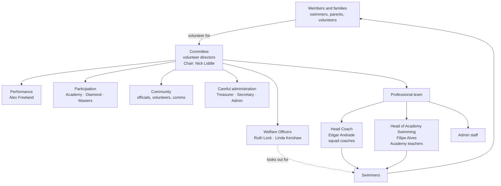

# How does Leander actually work?

Who runs the club, who coaches your swimmer, and where you fit in.

[PHOTO: parents and volunteers in club T-shirts at a poolside table during a gala, taken from behind, non-identifiable]

## The short answer

Leander is a not-for-profit swimming club, run by volunteers. A committee of parents and members (our directors) looks after the club's direction, money and welfare. A professional team of coaches, teachers and admin staff runs the swimming. And hundreds of families make it all happen, from timekeeping at galas to baking for cake sales.

There are no shareholders and no profit. Every pound goes back into the swimming.

---

## The two halves of the club

### The committee: volunteers who run the club

The committee are volunteers, mostly parents of swimmers, who are directors of the club. They are not paid. Between them they:

- set the club's direction and priorities
- look after the club's money and keep fees fair
- employ and support the professional team
- make sure every swimmer is safe and well looked after
- organise galas, socials and volunteers

### The professional team: the people on poolside

Our coaches and teachers are qualified professionals. They plan and deliver every session, from a five-year-old's first Academy lesson to Mercury, our national-level squad. Admin staff keep registrations, sessions and communication running.

The two halves work together, but each has its own job. Our coaches put it simply: *"Let the coach coach. Let the swimmer swim. Let the parent support."*

[See who's who: Coaches and team](/club/coaches-and-team)

---

## Our pillars, and who looks after each one

The club's strategy is built on three pillars, plus careful administration underneath them. Each has a lead from the committee, working with the professional team.

| Pillar | What it means | Who looks after it |
|---|---|---|
| **Performance** | Competitive excellence. Helping swimmers race at county, regional and national level, and beyond. | Alex Freeland (Coach Manager and performance lead), with Head Coach Edgar Andrade |
| **Participation** | Swimming for life, for everyone. The Academy (learn to swim), Diamond and Masters (our non-competitive squads), and inclusion for swimmers with a disability. | Academy: Gijs {{TBC: surname}}, with Head of Academy Swimming Filipe Alves. Diamond, Masters and inclusion: {{TBC: lead for Diamond, Masters and inclusion}} |
| **Community** | The Leander family. A warm welcome, friendships, galas, socials, volunteers and officials. | Officials and volunteers: Andrew {{TBC: surname}}. Communications: Henry {{TBC: surname}}. Welfare: Ruth Lock and Linda Kershaw |
| **Careful administration** | Keeping the club well run and financially sound, so it's still here for the next generation. | Treasurer: Rachel Tyson. Secretary: Sarah Flood. Administration: Jo {{TBC: surname}} |

**What's a pillar?** It's simply a way of making sure nothing gets forgotten. A swimmer chasing a national time, a seven-year-old learning breaststroke and an adult returning to the water all matter equally. *Different swimmers. Different goals. One team.*

---

## Who's who, at a glance

*Diagram to be supplied as an SVG in club colours for Squarespace.* {{TBC: confirm how committee members are appointed or elected, e.g. at an AGM}}

---

## Welfare: keeping every swimmer safe

Two Welfare Officers, **Ruth Lock and Linda Kershaw**, are new in post for 2026/27. They are the people to talk to if you're worried about a swimmer's safety or wellbeing, or about how anyone at the club is behaving.

- Email: **welfare@leanderswim.com**
- We follow **Wavepower**, Swim England's safeguarding policy. It sets out how clubs keep children safe and what happens if there's a concern.

[Read more: Safeguarding and policies](/club/safeguarding-and-policies)

---

## How decisions and communication flow

### How decisions are made

- **Training and squads:** the coaches decide. Session plans, squad moves and gala entries are coaching decisions, guided by our published squad standards.
- **Club direction, fees and budgets:** the committee decides, led by the Chair, Nick Liddle.
- **Welfare concerns:** go straight to the Welfare Officers, who follow Wavepower.
- {{TBC: how and when the committee meets, and how members can raise items or vote, e.g. AGM}}

### Who to talk to

| If your question is about… | Talk to |
|---|---|
| Your swimmer's training, progress or squad | Their coach (a quick word on poolside, or email) |
| The Academy, stages or the waiting list | admin@leanderswim.com |
| Fees, membership or payments | admin@leanderswim.com |
| A safety or wellbeing worry | welfare@leanderswim.com |
| Volunteering or becoming an official | Andrew {{TBC: surname}}, {{TBC: officials and volunteers email}} |
| Anything for the Chair | chair@leanderswim.com |

### Where you'll hear from us

- **This website:** news, results, explainers and gala pages.
- **TeamUnify:** our members' system for the calendar, gala entries, your account and payments. [LINK: TeamUnify – calendar]
- **Email** from the club and from your swimmer's coach.
- {{TBC: any other channels, e.g. WhatsApp groups or social media accounts}}

---

## Why every family's help matters

Leander has more than 500 swimmers. It runs because families give a little time.

**Officials matter most of all.** An official is a trained volunteer, such as a timekeeper, judge or referee. Without enough of them, a meet (a swimming competition) can't be licensed by Swim England. And if a meet isn't licensed, **the times swum there don't count** for rankings or qualifying. That's why every club, including ours, always needs more.

It's easier to start than you might think:

1. Do the online **Judge 1** course (from age 15).
2. Work as a mentored trainee at galas.
3. Qualify as a Judge 1, usually within a year.

Not ready for that? One-off help counts too: a shift at one of our Academy galas, a cake sale at Ernest Bevin, or helping at the summer social.

---

## What this means for your swimmer

- Their coach is a qualified professional, focused only on the swimming.
- Someone is always responsible for their welfare, and you know who it is.
- Their club is run for them, not for profit.
- When you help, even once a season, you help their races count.

---

## Related

- [Volunteer and become an official](/club/volunteer-and-officiate)
- [Coaches and team](/club/coaches-and-team)
- [Safeguarding and policies](/club/safeguarding-and-policies)
- [Beyond the pool](/club/beyond-the-pool)
- [Glossary](/club/glossary)

**Ready to help?** [Volunteer with us](/club/volunteer-and-officiate)
